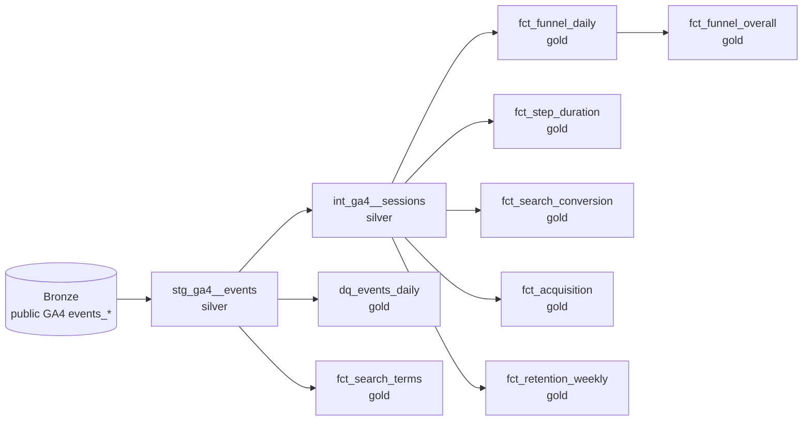
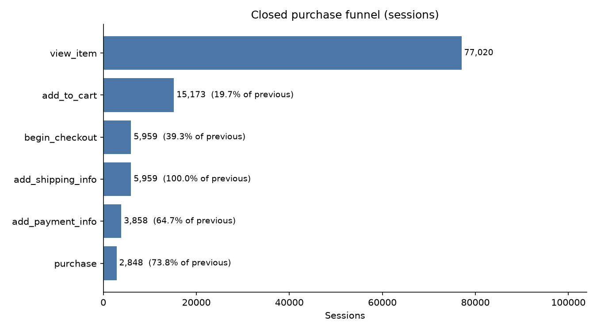
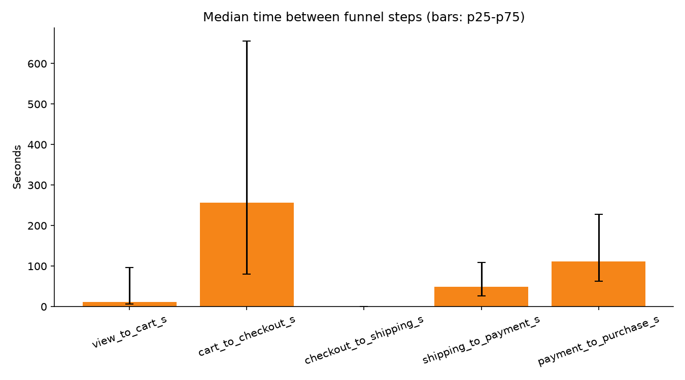

# GA4 e-commerce events: from raw tagged events to insights (BigQuery + dbt)

An analytics-engineering project on the public GA4 sample dataset of the Google Merchandise Store.
It takes nested, tagged event data (`event_params`, `items`) and turns it into tested, documented
tables that answer funnel, search, acquisition and retention questions, with a built-in
data-quality scorecard that explains **why two numbers for the "same" event can diverge**.

> Data: `bigquery-public-data.ga4_obfuscated_sample_ecommerce.events_*` (2020-11-01 to 2021-01-31, obfuscated sample).

## Business questions
1. Where do sessions drop in the purchase funnel, and how long does each step take?
2. Do sessions that use internal search convert differently from the ones that do not?
3. Which first-user sources/devices convert best?
4. How well are users retained week over week?
5. Can the tagging be trusted? (missing session ids, timezone shifts, collisions, funnel steps that skip)

## Architecture


| Layer | Models | What it does |
|---|---|---|
| Bronze | public dataset | Untouched source |
| Silver | `stg_ga4__events`, `int_ga4__sessions` | Flat events (one row per event), collision-safe `event_key`, own sessionization |
| Gold | `fct_funnel_daily`, `fct_funnel_overall`, `fct_step_duration`, `fct_search_conversion`, `fct_search_terms`, `fct_acquisition`, `fct_retention_weekly`, `dq_events_daily` | Business-ready facts and the data-quality scorecard |

Tests: unique / not null on keys, grain tests with `dbt_utils`, and reconciliation tests (staging row count equals source, funnel sessions equal total sessions, scorecard equals staging).

## Dataset at a glance
17 distinct events, 4,295,584 in total (reproduce with `sql/exploration/01_event_counts.sql`):

| event_name | events | event_name | events |
|---|---|---|---|
| page_view | 1,350,428 | add_to_cart | 58,543 |
| user_engagement | 1,058,721 | begin_checkout | 38,757 |
| scroll | 493,072 | select_item | 31,007 |
| view_item | 386,068 | view_search_results | 26,172 |
| session_start | 354,970 | add_shipping_info | 19,722 |
| first_visit | 257,462 | add_payment_info | 13,899 |
| view_promotion | 190,104 | select_promotion | 9,450 |
| purchase | 5,692 | click | 1,446 |
| view_item_list | 71 | | |

## Key findings
Period 2020-11-01 to 2021-01-31: 4,295,584 events, 17 event types, 360,129 sessions. Every number comes from the gold tables or `sql/exploration/`; details and open questions in [`docs/achados.md`](docs/achados.md).

**1. The same event can be counted 2x to 11x too high.** `FROM events, UNNEST(items)` changes the unit from events to item rows: `add_to_cart` goes from 58,543 events to 667,426 rows (11.4x), `select_item` 10.6x, `view_item` 7.1x, `purchase` 2.8x. Events without items (`page_view`, `session_start`, ...) disappear entirely.

**2. Session conversion is 1.35%, and the funnel depends on its definition.** 4,848 of 360,129 sessions contain a purchase. A closed funnel (every earlier step must appear in the session) keeps only 2,848 of them: all 2,000 purchase sessions it drops have no `add_to_cart`.

| Closed funnel (sessions) | Sessions | % of previous |
|---|---|---|
| view_item | 77,020 | |
| add_to_cart | 15,173 | 19.7% |
| begin_checkout | 5,959 | 39.3% |
| add_shipping_info | 5,959 | 100% |
| add_payment_info | 3,858 | 64.7% |
| purchase | 2,848 | 73.8% |



**3. Events vs sessions flips the story.** At event level, `begin_checkout` to `purchase` is 14.7% (5,692 / 38,757). At session level it is 47.8% (2,848 / 5,959), because a session fires `begin_checkout` about 3.5 times.

**4. Tagging quirks worth a conversation with the tracking owner.**
- `add_shipping_info` fires in 99.8% of the sessions that start checkout (11,086 of 11,106), a median 0 s after `begin_checkout`: it behaves like part of the same step.
- 5,145 of 11,106 checkout sessions have no `add_to_cart` in the session. A cart from an earlier session explains only 379 of them (7.4%); the rest is unexplained (a path to checkout without `add_to_cart`, or a tagging gap).
- `view_item_list` has 71 events against 31,007 `select_item`.



**5. Internal search correlates with conversion.** 4.4% of sessions use search (15,719); 4.14% of those purchase versus 1.22% of sessions without search (3.4x). This is correlation: people who search probably arrive with higher intent.

**6. Data quality checks.** Every event carries a session id, and no same-timestamp collisions were found. `event_date` equals the UTC date of `event_timestamp` (0 mismatches, versus 12% to 33% for Sao Paulo, New York and Los Angeles), so the timezone is a measured fact, not an assumption.

## Lessons learned
- **Grain is everything.** `FROM events, UNNEST(items)` changes the unit from events to items and drops events without items; counts silently inflate. Every model is guarded by a reconciliation test.
- **No event id, no problem, but be explicit.** The surrogate key keeps colliding events instead of merging them, and the scorecard measures how often that happens.
- **Define the metric before comparing tools.** Events vs sessions vs users, UTC vs property timezone, and open vs closed funnels can all explain a gap between two dashboards.
- **A green test suite can still be an empty table.** In a BigQuery sandbox project, partitions expire after 60 days, so partitioning historical data by event date produced a table with zero rows while `unique` and `not_null` passed. Only the reconciliation test against the source caught it; the fix was to cluster instead of partition.
- **A green test suite can still be an empty table.** In a BigQuery sandbox project, partitions expire after 60 days, so partitioning historical data by event date produced a table with zero rows while `unique` and `not_null` passed. Only the reconciliation test against the source caught it; the fix was to cluster instead of partition.
- **A green test suite can still be an empty table.** In a BigQuery sandbox project, partitions expire after 60 days, so partitioning historical data by event date produced a table with zero rows while `unique` and `not_null` passed. Only the reconciliation test against the source caught it; the fix was to cluster instead of partition.

## Repository layout
```
models/staging        silver: flat events
models/intermediate   silver: sessions
models/marts          gold: facts + data-quality scorecard
macros/ga4_param.sql  scalar extraction of event_params
sql/exploration       numbered exploration queries (run with dry run first)
tests/                reconciliation tests
scripts/              dry_run.sh, run_query.sh, make_charts.py
docs/                 step-by-step guide (PT-BR), design decisions, findings template
```

## Run it
Full guide (PT-BR): [`docs/passo_a_passo.md`](docs/passo_a_passo.md). Short version:
```bash
python3 -m venv .venv && source .venv/bin/activate
pip install -r requirements.txt
cp profiles.yml.example ~/.dbt/profiles.yml   # set your GCP project (dataset location must be US)
dbt deps
dbt build --vars '{"start_date": "20210101", "end_date": "20210131"}'   # cheap one-month run
dbt build                                                               # full period
```
Cost controls: `_TABLE_SUFFIX` filters via vars, clustered silver tables (not partitioned, see docs/decisoes.md), no `SELECT *`, `maximum_bytes_billed` in the profile, dry run before manual queries.

Design decisions and caveats (first-user traffic source, left-censored cohorts, obfuscated sample): [`docs/decisoes.md`](docs/decisoes.md).
